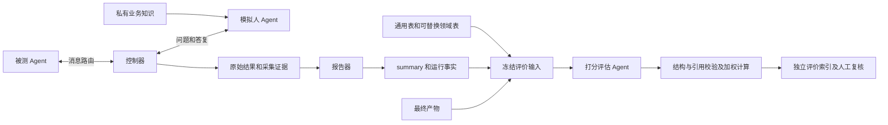

# 结果评价架构与规范 v2

## 目标与范围

以 010 的自然语言双 Agent 运行结构为标准，建立业务无关的事后打分机制。评价登录、数据导出或其他新功能时，仅替换领域评分表及本次运行证据，不在脚本内增加业务名称分支。

评价不改变控制器停止条件，不替模拟人答复，不实现产品功能，不授权验收或发布。原始运行结果与评价结果分开保存。旧 Oracle 矩阵不是本规范输入，也不要求为其新增兼容适配。

## 组件职责

| 组件 | 输入与职责 | 不负责 |
| --- | --- | --- |
| 被测 Agent | 调查、提问、吸收业务答案、交付本次任务产物 | 自行批准未知业务规则 |
| 模拟人 Agent | 私有业务知识与实际问题；回答已问内容，保留未知 | 评分、主动补漏、决定对话停止 |
| 控制器 | 路由、预算、回复与送达记录、完成声明、产物检查、停止原因 | 需求语义评分 |
| 报告器 | 从原始记录生成 summary/report 和客观耗时 | 推断没记录的行为、用状态代表质量 |
| 打分评估 Agent | 通用评分指导、领域表、summary、运行事实、产物；判断语义与扣分理由 | 改权重、调用工具修复产物、批准业务 |
| 评价脚本 | 准备输入、隔离调用、验证模型与 JSON/引用、权重计算和展示 | 用关键词判断业务正确性、替模型写评分理由 |
| 人工评审 | 审核评分表、事实冲突、评价一致性与比较结论 | 将一次自动打分当作最终业务批准 |



运行器使用 [DialoguePolicy.psm1](../../tools/DialoguePolicy.psm1) 的 `Get-DialogueCompletionFacts` 生成事实；报告器和评价适配器复用同一函数，不分别猜测“有没有最终回复”。打分指导位于 [result-quality-evaluator.agent.md](../../agents/result-quality-evaluator.agent.md)，不复制进业务 Agent。

## 控制器事实契约

新运行在 result 中保存 `completionFacts`，报告器在 report 中生成同名投影并展示于 summary。对 010 已有记录可从 `rawResponse` 回算协议状态，不修改原始 result 或补记送达。

| 字段 | 含义 |
| --- | --- |
| `targetReplies[].replyPresent` | 本次调用是否记录了非空回复文本 |
| `controlParsed` / `reportedStatus` | 控制行是否可解析及其状态；不能凭正文猜“完成” |
| `responseSource` | `response` 或 `rawResponse` |
| `deliveryStatus` / `delivered` | 是否有送达记录；未记录不等于从未生成回复 |
| `finalReplyPresent` / `finalReplyDelivered` | 最后一次 Target 调用的回复/送达事实 |
| `finalTargetStatus` | `waiting_reply`、`role_task_completed`、`blocked`，或状态未知/无回复记录 |
| `completionClaimed` | 最后 Target 控制状态是否声明角色任务完成 |
| `deliveryVerified` | 控制器当时的产物检查是否通过；不是语义验证 |
| `stopReason` / `originalOutcome` | 原控制决策/错误和原始运行状态 |

010 Luna 应表示：有 rawResponse、状态 waiting_reply、无送达记录、未声明完成、无核验交付，控制器因工具错误停止。不得用 `no_final_target_reply` 代替这些独立事实。

产物文件在评价时读到的内容是当前文件快照；原控制器的 verified 状态属于历史检查，不保证文件后来未被修改。评价输入冻结后，离线复验不再读取当前产物。没有历史内容快照时，不宣称已还原运行结束时的精确文件。

## 评分契约

通用表和领域表均含 schemaVersion=1、id、version、scale=0–4，以及 criteria（id/title/description/weight）。每张表内部权重必须合计 100，权重必须为正数；跨表 criterion ID 不能重复。

- 有领域表：通用占 50，领域占 50；最终维度权重 = 表内权重 × 0.5。
- 无领域表：通用占 100；仅评价通用质量，不声称核验隐藏业务完整性。
- 程序给模型的 criteria 和报告中的 weight 均为最终权重，合计 100；保留 group、rubricWeight 供追溯。
- 模型每维返回 0–4 整数、理由和来源引用；程序不擅自改模型的语义分数。
- 证据完整时：总分 = sum(weight × score) / 100；百分比 = 总分 / 4 × 100。当前展示保留两位总分，百分比按展示总分换算。

### 通用维度

| 维度 | 判断边界 |
| --- | --- |
| evidence_fidelity | 结论有依据、不伪造批准；虚假完成声明属于此项缺陷 |
| confirmed_scope_coverage | 已确认答案是否落实到产物，不把未问到的规则当作已回答 |
| open_decision_integrity | 实际提出的未决是否如实保留；妥善记录待决不扣分 |
| artifact_testability | 内容结构、可追溯性、可验证性；文件存在不是满分 |
| completion_and_delivery | 实际任务完成度；诚实未完成也不能获得完成分 |

需要文件交付的任务，完成度锚点：0=未交付；1=存在产物但必要交付检查失败；2=可用的部分交付但大量工作缺失；3=交付已核验但仍有小缺陷；4=交付已核验且无交付缺陷。获准带待决的草稿可取得交付满分。基础设施或控制器中断需解释归因，但不转化为完成分；也不能因此概括模型没有完成能力。

### 领域解耦与归因

领域表由业务负责人审核，列明必要检查点、批准行为及未知边界。相同评分指导适用于任何领域。规则未出现在对话中时，评价其调查/提问覆盖，不要求模型事先知道准确隐藏答案。

发现必须区分：未发现/未询问、已问但未批准、已回答但未落实、与批准答案矛盾、交付失败、虚假交付。不要用待决数量或“全部完成”措辞代替判断。同一缺陷影响多个维度时，逐项说明不同影响，不在同一维度重复扣分。

耗时、调用次数及 capture 中费用是独立客观信息；当前质量分不包含速度。预算/任务/评分表不同、运行中断或评价证据不完整的样本，不能直接据分数排序。每组单次评价仍可能有模型偏差。

## 输入输出与安全

运行目录为 010 风格：comparison.json.conditions 指向各条件 dialogue；每组包含 result.json、config.json、summary.md，可选 report.json；产物位置由 repositoryPath 和声明/核验相对路径提供。评分不自动读取 Oracle、模拟人知识全文或其他条件材料。

每次输出必须是新目录；沿用“顶层索引 → 条件详情”结构：

```text
evaluation-<attempt>/
  summary.md                   # 模型、原状态、耗时、分数、引用状态
  evaluation.json
  <condition>/
    evaluation-input.txt       # 完整 rubric、summary、facts、产物快照
    run-facts.json
    evaluator.agent.md
    input-manifest.json        # 输入、facts、Agent 哈希
    evaluation.json
    evaluation.md
    evaluator-workspace/       # 新调用使用
    capture/                   # 原始回复、CLI 版本、模型与用量证据
    copilot-home/
```

固定评价模型必须由操作员指定，不接受 auto；采集退出成功且实际模型证据匹配后才处理回复。设置 NoTools、禁 MCP/项目指令，输入材料按不可信数据处理。CLI 参数不是 OS 沙箱，实际暴露工具依赖 CLI；已知 CLI 可能仍显示 skill/sql，不能仅凭参数宣称零工具暴露。报告输入可能含业务数据，应保存在私有目录，不提交仓库或回传被测 Agent。产物拒绝路径越界及链接路径，单文件大小默认限制 512 KiB。

## 引用与状态

引文仅来自 summary.md、run-facts.json 或产物路径。短连续原文优先，表格使用单元格文本。校验允许空白/表格管道格式归一化，不做语义近似匹配。无效引文单列 citationWarnings，不作为有效证据；无有效引文的维度 score=null，保留 modelProposedScore。引用存在仍需 Agent 判断它是否支持理由。

| 评价状态 | 条件与用途 |
| --- | --- |
| completed | 每维有有效引用且无引用警告；不是业务验收 |
| completed_with_citation_warnings | 每维仍有有效引用，部分引用被剔除；分数需人工复核 |
| partial_evidence | 至少一维无有效引用；不提供总分，不按剩余权重放大分数 |
| failed | 调用/实际模型/协议/输入校验失败，保留诊断，无有效评价 |

`evidenceCoveragePercent` 为兼容保留的 JSON 字段，界面称“有效引用维度权重占比”，不是业务覆盖率。`comparisonEligible` 只检查引用层的完整性，不能代替任务、预算、评分版本和运行完整性的人工可比性审查。旧运行 outcome 不被评价状态覆盖。

## 版本与复验

本规范使用 result-quality-v2、逐条件 evaluation schemaVersion=2、通用 rubric v2。改变指导、维度、权重或业务规则须产生新评价，不能修改旧分数冒充新标准。

ReplayCaptureRoot 仅用于同标准的本地重新校验：检查 Agent 哈希、协议、rubric 版本及完整 criteria、原输入/facts 哈希、原始实际模型，然后使用 capture/input.txt 内的冻结材料。复验不重新调用模型；原回复与先前输出不覆盖。旧 010 v1 capture 缺少 v2 契约，必须保留为试评，不能作为 v2 评分。

## 验收与限制

假 CLI 回归验证权重100、跨业务 rubric、原状态不变、010式 rawResponse 中断事实、空 Participant 计时、缺产物、引用异常、实际模型校验及冻结输入复验路径；假模型不能验证语义打分好坏。真实评分需操作员授权调用并人工校准，尤其检查少问快速完成、带待决完整交付和控制器中断三类样本。

当前输出保留逐条件失败并继续其他条件；操作者必须检查顶层 results/status，不能只看命令退出码。文件事实与引文真实性不等于评分可靠性；新指导尚需真实模型校准。本次修订不重评010，不把之前分数作为v2结果。